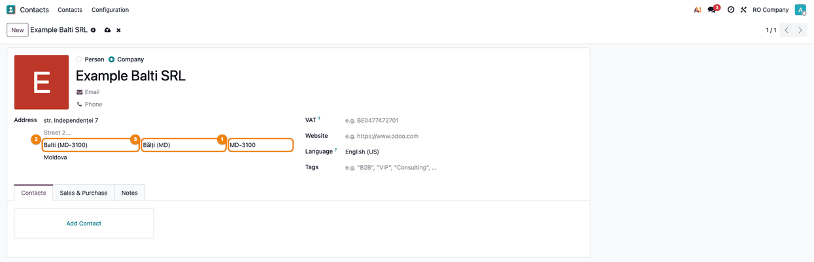
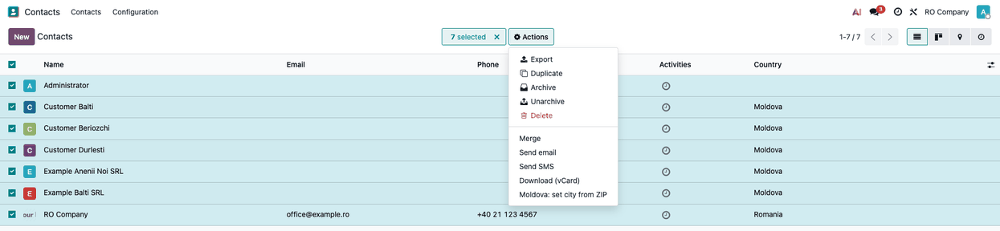
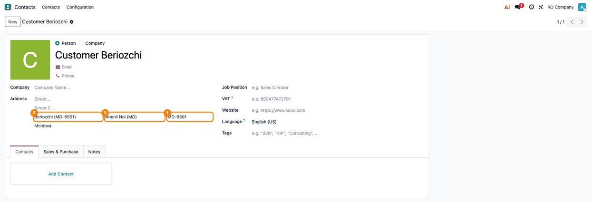

=======================
Moldova - City from ZIP
=======================

..
   !!!!!!!!!!!!!!!!!!!!!!!!!!!!!!!!!!!!!!!!!!!!!!!!!!!!
   !! This file is generated by oca-gen-addon-readme !!
   !! changes will be overwritten.                   !!
   !!!!!!!!!!!!!!!!!!!!!!!!!!!!!!!!!!!!!!!!!!!!!!!!!!!!
   !! source digest: sha256:bdebe5bd24d25058d4b0a82737c98a13d73ecb57c97aa15e17c4f572b7fc3b54
   !!!!!!!!!!!!!!!!!!!!!!!!!!!!!!!!!!!!!!!!!!!!!!!!!!!!

.. |badge1| image:: https://img.shields.io/badge/maturity-Beta-yellow.png
    :target: https://odoo-community.org/page/development-status
    :alt: Beta
.. |badge2| image:: https://img.shields.io/badge/license-LGPL--3-blue.png
    :target: http://www.gnu.org/licenses/lgpl-3.0-standalone.html
    :alt: License: LGPL-3
.. |badge3| image:: https://img.shields.io/badge/github-dhongu%2Fl10n--moldova-lightgray.png?logo=github
    :target: https://github.com/dhongu/l10n-moldova/tree/20.0/l10n_md_zip
    :alt: dhongu/l10n-moldova

|badge1| |badge2| |badge3|

Loads the Moldovan localities with their postal code and district, and
fills in the city and the district of Moldovan addresses from the postal
code.

- Ships the list of Moldovan localities with their postal code, linked
  to the 37 subdivisions of the Republic of Moldova (ISO 3166-2:MD: the
  districts, the municipalities Chișinău, Bălți and Bender, Găgăuzia and
  Stînga Nistrului), which the module adds as states of Moldova. The
  data comes from `GeoNames <https://www.geonames.org>`__ (Creative
  Commons Attribution 4.0).
- Moldova is set to *enforce cities*: the city of a Moldovan address is
  chosen from the list.
- On the contact form, typing the postal code (cod poștal) of a Moldovan
  address sets the city and the district. The postal code can be typed
  as ``MD-3100``, ``MD3100`` or ``3100``: when the locality is
  identified, it is written back as ``MD-3100``. A postal code shared by
  several localities sets only the district, when they are all in the
  same district; the city name, when it matches one of them (without
  diacritics and case), picks the locality.
- The action *Moldova: set city from ZIP* on contacts links the Moldovan
  contacts to the city of their postal code and fills in the district.
- At install, the Moldovan contacts are linked: directly on a small
  database, by the scheduled action *Moldova: link contacts to the city
  of their ZIP* in batches on a large one (it deactivates itself when
  done).

**Table of contents**

.. contents::
   :local:

Usage
=====

1. As an administrator, open **Contacts → Configuration → Localization →
   Cities** and search for a postal code, for example ``MD-6501``: the
   Moldovan localities of that postal code are listed with their
   district in the **State** column.

   |Cities list filtered on the postal code MD-6501: Anenii Noi,
   Beriozchi and Hirbovatul Nou, all with the country Moldova and the
   state Anenii Noi (MD)|

2. Open a contact with the country **Moldova** and type the postal code
   in the address, for example ``MD-3100``: the city and the state are
   filled in. The code can also be typed as ``3100``, ``MD3100`` or
   ``md 3100``; when the locality is identified, it is written back as
   ``MD-3100``.

   |Contact Example Balti SRL in Moldova: the postal code MD-3100 fills
   in the city Balti (MD-3100) and the state Bălți (MD)|

3. When the postal code is shared by several localities (``MD-6501``),
   only the state is filled in (when the localities are all in the same
   district); choose the city from the list (type the postal code or the
   name in the **City** field). When the contact already has the city
   name, for example *BERIOZCHI*, that locality is chosen by itself
   (diacritics and letter case are ignored).

   |Contact Example Anenii Noi SRL: the postal code MD-6501 fills in the
   state Anenii Noi (MD); the City field lists Anenii Noi, Beriozchi and
   Hirbovatul Nou, all with MD-6501|

4. To complete existing or imported contacts, select them in the list
   view of **Contacts** and run **Actions → Moldova: set city from ZIP**
   (right *Contact: Creation*). Select the companies, not their contact
   persons: a contact person takes the address of its company. Contacts
   of other countries are left as they are.

   |Contacts list with 7 contacts selected and the Actions menu open;
   its last row is Moldova: set city from ZIP|

   After the action, a contact imported with the code ``6501`` and the
   city *Beriozchi* has the code ``MD-6501``, the city *Beriozchi* and
   the state *Anenii Noi*.

   |Contact Customer Beriozchi after the action: ZIP MD-6501, city
   Beriozchi (MD-6501) and state Anenii Noi (MD)|

At install, the Moldovan contacts that have a postal code are linked to
their city: directly on a small database, or by the scheduled action
*Moldova: link contacts to the city of their ZIP*, in batches, on a
large one (it deactivates itself when done).

The names of the localities come from GeoNames without diacritics
(*Balti*, *Durlesti*); the states have them (*Bălți*, *Chișinău*).

.. |Cities list filtered on the postal code MD-6501: Anenii Noi, Beriozchi and Hirbovatul Nou, all with the country Moldova and the state Anenii Noi (MD)| image:: https://raw.githubusercontent.com/dhongu/l10n-moldova/20.0/l10n_md_zip/static/description/en/01_lista_localitati_cap.png

.. |Contact Example Anenii Noi SRL: the postal code MD-6501 fills in the state Anenii Noi (MD); the City field lists Anenii Noi, Beriozchi and Hirbovatul Nou, all with MD-6501| image:: https://raw.githubusercontent.com/dhongu/l10n-moldova/20.0/l10n_md_zip/static/description/en/03_partener_cap_comun.png

Changelog
=========

20.0.1.0.0 (2026-11-17)
-----------------------

**Added**

- Moldovan localities with postal code and district, from GeoNames; the
  37 subdivisions of ISO 3166-2:MD as states of Moldova.
- City and district filled in from the postal code on Moldovan
  addresses; action and scheduled action to link the existing contacts.

Bug Tracker
===========

Bugs are tracked on `Terrabit Issues <https://www.terrabit.ro/helpdesk>`_.
In case of trouble, please check there if your issue has already been reported.

Do not contact contributors directly about support or help with technical issues.

Credits
=======

Authors
-------

* Terrabit

Maintainers
-----------

.. |maintainer-dhongu| image:: https://github.com/dhongu.png?size=40px
    :target: https://github.com/dhongu
    :alt: dhongu

Current maintainer:

|maintainer-dhongu| 

This module is part of the `dhongu/l10n-moldova <https://github.com/dhongu/l10n-moldova/tree/20.0/l10n_md_zip>`_ project on GitHub.

You are welcome to contribute.